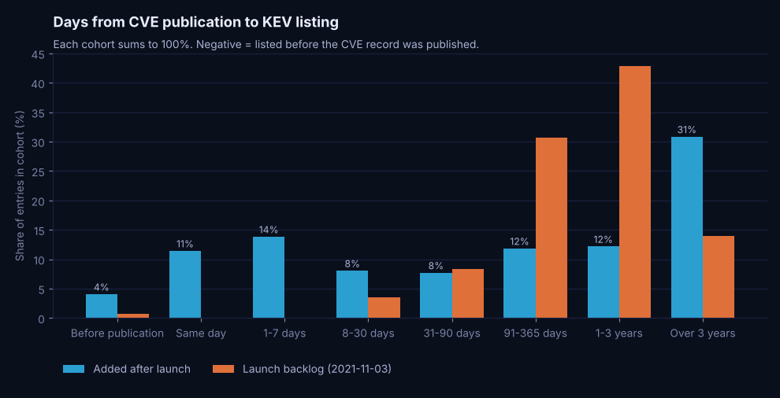

# Known Exploited Vulnerabilities: how fast disclosure turns into exploitation

A DuckDB, Python and Power BI project on CISA's Known Exploited Vulnerabilities (KEV) catalog joined to the
official CVE records. I measure how long it takes from a CVE going public to CISA confirming it is exploited
in the wild, how that has changed, and what it means for patch prioritization compared with sorting by CVSS
severity alone.

Snapshot: KEV catalog version **2026.10.08** (1,739 entries), retrieved 2026-10-11, plus one CVE JSON 5.x
record per entry (1,739 of 1,739 found) and a random sample of 6,000 CVE IDs as a severity baseline.



## Question

Once a vulnerability is publicly disclosed, how quickly does it show up as confirmed exploited (CVE
`datePublished` to KEV `dateAdded`)? How has that window changed? And what does it mean for a team that
prioritizes patches by CVSS severity?

## What I found

Full write-up with definitions, baselines and limits: [`docs/findings.md`](docs/findings.md).

| | Value | Definition |
|---|---|---|
| Listed within 7 days of publication | 29.3% | Entries added after the November 2021 launch batch (n = 1,452) |
| Listed more than a year after publication | 43.0% | Same entries; the distribution has two humps, so the median (166.5 days) sits between them |
| Median age at listing, last 24 months | 20 days | Entries added 2024-10-08 to 2026-10-08 |
| Entries not rated Critical | 64.8% | CVSS in the CVE record, CNA score first, then CISA's enrichment |
| KEV entries a Critical-only rule would catch | 23.0% | CVE IDs 2021-2025, CNA's own score |
| Known ransomware use | 20.8% | `knownRansomwareCampaignUse = Known` |
| Share of entries from the top 10 vendors | 53.2% | 284 vendors after name normalization |

* The gap is bimodal. Since 2023, roughly half of each year's additions were published within the previous
  30 days, and about a fifth to a quarter were more than a year old.
* Critical CVEs are listed far more often than others: for 2021-2025 IDs I estimate 2.5% of CNA-Critical
  CVEs are in KEV, against 0.63% of High and 0.16% of Medium. But most KEV entries from those years were not
  rated Critical by their CNA, and 39% had no CNA score at all. This is an association measured against a
  random sample; it does not show that severity causes exploitation.

## Pipeline

```
cisagov/kev-data (CSV + JSON) ─┐
                               ├─► ingest ─► data/sample/ (committed) ─► DuckDB sql/00-04 ─► validations (fail loudly)
CVEProject/cvelistV5 (JSON)  ──┘   cache        KEV snapshot, CVE fields,     raw → staging → model       │
  1 record per KEV entry           (git-        random baseline, licences      → analytics                 ├─► pandas re-computation + reconciliation
  + 6,000 random IDs               ignored)                                                                 ├─► website JSON, Power BI CSVs, figures
                                                                                                            └─► notebook
```

| Module | Responsibility |
|---|---|
| [`ingest.py`](src/kev_analytics/ingest.py) | Downloads with retries and at most 8 parallel requests; 404 recorded as "not found", never invented; clear error when offline |
| [`clean.py`](src/kev_analytics/clean.py) | CVE record flattening and **CVSS precedence**, vendor normalization, date rules, launch-backlog rule, CWE bridge |
| [`baseline.py`](src/kev_analytics/baseline.py) | Random sample of CVE IDs (2021-2025) and the population estimate with bootstrap intervals |
| [`snapshot.py`](src/kev_analytics/snapshot.py) | Writes `data/sample/`: KEV CSV, manifest with hashes, CVE fields, licence texts |
| [`warehouse.py`](src/kev_analytics/warehouse.py) | Runs `sql/00..04` into DuckDB and raises if any error-level validation fails |
| [`analyze.py`](src/kev_analytics/analyze.py) | Re-computes the headline metrics in pandas and reconciles them with SQL |
| [`export.py`](src/kev_analytics/export.py), [`figures.py`](src/kev_analytics/figures.py) | Website JSON, Power BI CSVs and expected values, PNG charts, metrics snapshot |

SQL (DuckDB dialect, documented in each file header):

| File | Contents |
|---|---|
| [`00_schema.sql`](sql/00_schema.sql) | Schemas and raw tables (all text) |
| [`01_staging.sql`](sql/01_staging.sql) | Loads files; typed staging of KEV, CVE fields and the baseline |
| [`02_transformations.sql`](sql/02_transformations.sql) | `fact_kev` (one row per entry), `dim_vendor` + `vendor_map`, `dim_date`, `bridge_kev_cwe`, `dim_cwe` |
| [`03_analytics.sql`](sql/03_analytics.sql) | Percentiles, running totals, rankings, rolling 12-month additions, cohorts by publication year, sensitivity rules, baseline comparison |
| [`04_validation.sql`](sql/04_validation.sql) | 50 checks: keys, referential integrity, bridge fan-out, dates, reconciliation to the raw snapshot |

## Run it

```bash
cd projects/known-exploited-vulnerabilities
python -m venv .venv && source .venv/bin/activate      # Windows: .venv\Scripts\activate
pip install -r requirements-dev.txt

python -m pytest                                        # rule tests on a fixture + data contract
PYTHONPATH=src python -m kev_analytics all              # build + validate + reconcile + export (offline)
python notebooks/build_notebook.py                      # re-execute the exploratory notebook

# Refresh from the sources (network; cache outside the repo)
KEV_CACHE_DIR=~/kev-cache PYTHONPATH=src python -m kev_analytics refresh
```

`all` works from the committed files in `data/sample/` and needs no network. Refreshing is described in
[`data/README.md`](data/README.md).

Last run on the snapshot above: 50 validations (49 pass, 1 warning: two entries whose CISA-ADP `kev.dateAdded`
in the CVE record differs from the catalog by three days), 62 of 62 metrics identical in SQL and pandas,
79 tests passing.

## Outputs

| Output | Purpose |
|---|---|
| `data/sample/` | KEV snapshot (CC0), manifest with SHA-256 and retrieval time, extracted CVE fields, random CVE baseline, licence texts |
| `outputs/validation_results.csv` | Every SQL check with observed and expected values |
| `outputs/reconciliation.csv` | Metric, SQL value, pandas value, match |
| `outputs/metrics_snapshot.md` | All values the docs quote, regenerated by `export` |
| `outputs/figures/*.png` | Six charts used in the docs |
| `powerbi/` | Star-schema CSVs, Power Query M, DAX measures, theme, expected values ([README](powerbi/README.md)) |
| `notebooks/exploratory_analysis.ipynb` | Profiling and exploration, executed with outputs |
| `../../website/src/data/generated/known-exploited-vulnerabilities/*.json` | Data for the case-study page ([fields](outputs/website-data/README.md)) |

## Documentation

* [`docs/methodology.md`](docs/methodology.md): definitions, date handling, the launch-backlog rule, CVSS
  precedence, vendor normalization, the random baseline and its estimator.
* [`docs/findings.md`](docs/findings.md): each finding with its metric, source, baseline, scope, alternative
  explanations and limits, then next steps for a vulnerability-management lead.
* [`docs/data-quality-report.md`](docs/data-quality-report.md): duplicates, missing and rejected records,
  date conflicts, notes, and what each check found.
* [`docs/data-dictionary.md`](docs/data-dictionary.md): every table and column, with grain and units.

## Licences

* KEV: CC0 1.0 ([`data/sample/KEV_LICENSE.txt`](data/sample/KEV_LICENSE.txt)). Use of the data does not imply
  endorsement by CISA or DHS, and no CISA logo or DHS seal is used.
* CVE records: CVE Program Terms of Use, with MITRE's copyright notice reproduced in
  [`data/sample/CVE_TERMS_OF_USE.txt`](data/sample/CVE_TERMS_OF_USE.txt).

## Limitations

* KEV lists what CISA has confirmed. Exploitation it has not confirmed is invisible here, so every rate is a
  lower bound and the catalog reflects CISA's attention as well as attacker behaviour.
* `datePublished` is when the CVE record went public. For some CNAs that is weeks after the vendor advisory,
  which is why 61 entries were listed before their record was published.
* The severity comparison uses a sample of 3,340 published records; its population figures are estimates.
* Power BI Desktop was not available, so no `.pbix` or `.pbip` exists; the DAX and M have not been run.
