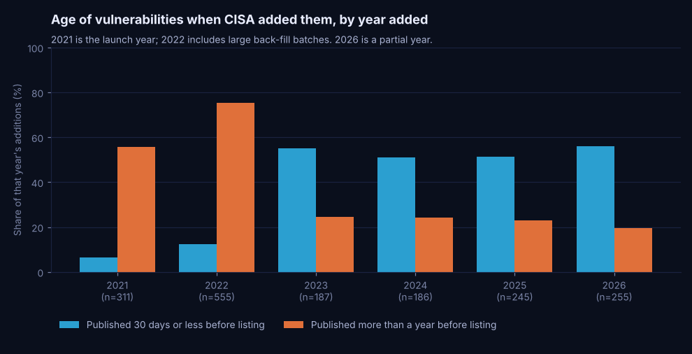
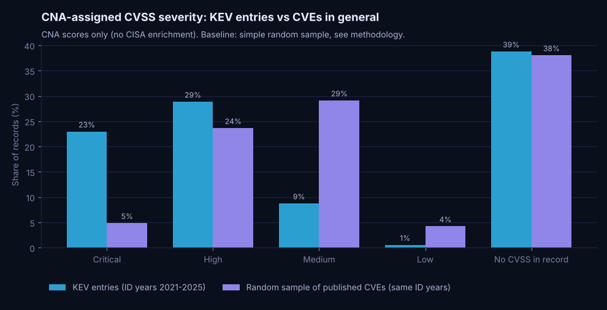
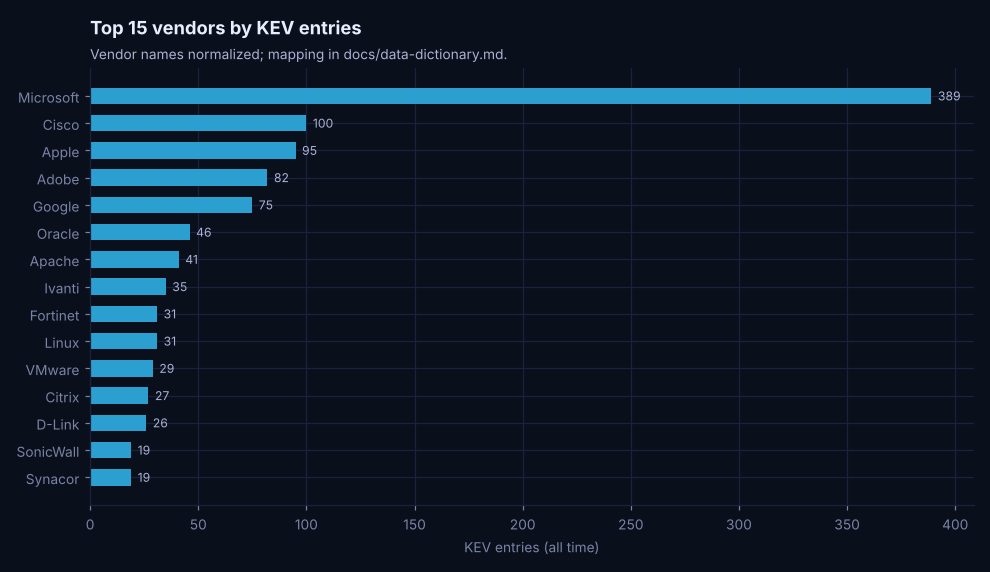
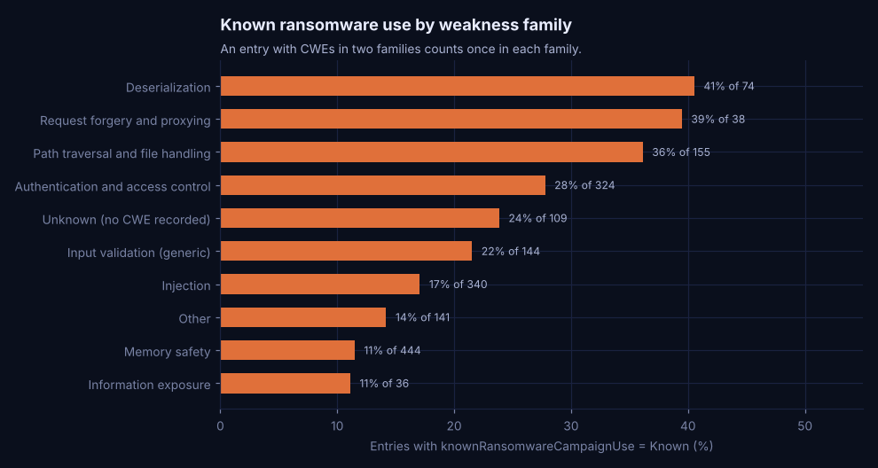

# Findings

Snapshot: KEV catalog 2026.10.08 (1,739 entries), CVE records fetched 2026-10-11. Every value below is in
`outputs/metrics_snapshot.md`, `outputs/reconciliation.csv` or the website JSON, all written by
`python -m kev_analytics all`. "Post-launch" means entries added after the 287-entry launch batch of
2021-11-03 (1,452 entries). Definitions are in [`methodology.md`](methodology.md).

---

## 1. Listings split into new and old vulnerabilities

Of the 1,452 post-launch entries, 29.3% were listed within 7 days of the CVE record being published, and 15.5%
were listed on or before that day. At the other end, 43.0% were more than a year old when CISA listed them, and
30.9% were more than three years old. The median is 166.5 days, with quartiles of 4 and 1,514 days, which says
less than the two shares do: the distribution has one hump in the first week and another years out.

| | |
|---|---|
| **Metric and units** | Lag = KEV `dateAdded` minus the UTC date of CVE `datePublished`, whole days. Shares are fractions of post-launch entries. |
| **Source** | `analytics.headline` (`post_*` columns), `analytics.lag_distribution`; reconciled in `outputs/reconciliation.csv` |
| **Baseline** | The launch batch, as a reference for back-filled entries: median 467 days, 0.7% within 7 days. |
| **Scope** | All post-launch entries with a CVE record (all of them in this snapshot). |
| **Why it matters** | A patch process tuned only for new vulnerabilities misses the 43% that were already old when listed, and a monthly patch cycle is slower than 29% of listings. |
| **Alternative explanations** | Part of the old hump is CISA catching up on exploitation that was already known (heavy in 2022) rather than new attacks on old bugs. The fast hump is partly vendors disclosing and patching zero-days that were already being exploited, so there the lag measures time to public disclosure of an exploited bug more than time to exploitation. |
| **Limits** | `datePublished` can trail the vendor advisory (61 entries were listed before their record was published), so some fast lags are understated or negative. KEV records the date CISA confirmed exploitation, not the date it began, and only exploitation CISA confirmed. |

## 2. Since 2023, about half of each year's additions were recent CVEs

In 2022, a year of large back-fill batches, 12.3% of additions had been published within the previous 30 days
and the median age at listing was 1,436 days. From 2023 to 2026 that share was 55.1%, 51.1%, 51.4% and 56.1%,
and the median age was 12, 21.5, 26 and 15 days. The share older than a year fell from 75.3% of 2022 additions
to between 19.6% and 24.6% from 2023 on. Over the last 24 months the median age at listing was 20 days.

By publication cohort (post-launch entries), the median lag was 24 days for CVEs published in 2022, 6 for
2023, 11 for 2024 and 8 for 2025. In each cohort since 2022 most entries arrived within a year of publication
(112 of 131 for 2022, 145 of 166 for 2023, 149 of 160 for 2024).

| | |
|---|---|
| **Metric and units** | Per year added: share of additions with a lag of 30 days or less; median lag in days. Per publication year: median lag. |
| **Source** | `analytics.lag_by_added_year`, `analytics.lag_by_published_year`, `analytics.cohort_cumulative` |
| **Baseline** | 2022 additions; earlier publication cohorts. |
| **Scope** | All entries by year added (2026 runs to 2026-10-08); post-launch entries by publication year. |
| **Why it matters** | For a team setting patch deadlines, the recent pattern (about half of listings within a month of publication) is the relevant one. The catalog-wide median is inflated by back-filling. |
| **Alternative explanations** | The drop after 2022 probably reflects CISA finishing its back-fill more than any change in attackers; this data cannot separate the two. Publication-cohort medians fall partly by construction: recent cohorts have had less time for slow listings to appear (right-censoring), and pre-2021 cohorts can only show long lags because KEV did not exist when they were new. |
| **Limits** | The year-to-year differences within 2023-2026 are small next to the 2022 shift, and I do not read a trend into them. Cohorts from 2025 and 2026 have less than a year of follow-up. |

## 3. Critical CVEs are listed more often, but most listed CVEs are not Critical

Across the whole catalog, 64.8% of entries are not rated Critical under the record's CVSS (CNA score first,
then CISA's enrichment), and 56.9% have no score from their CNA at all.

KEV holds only exploited CVEs, so to ask whether severity relates to exploitation I need CVEs that were not
listed. I compared KEV entries with 2021-2025 CVE IDs against a random sample of published CVE records with the
same ID years, using the CNA's own score on both sides. Critical makes up 23.0% of those KEV entries against
4.9% of the sample; Medium is 8.8% against 29.1%. Scaling the sample to the frame, I estimate that 2.50% of
CNA-Critical CVEs are in KEV (95% interval 2.16% to 2.92%), against 0.63% of High (0.59% to 0.67%) and 0.16% of
Medium (0.15% to 0.17%). Records with no CNA score are listed at 0.58%, close to the High rate.

| | |
|---|---|
| **Metric and units** | KEV share by band (fraction of entries); KEV rate = KEV entries in a band / estimated published CVEs in that band, fraction. |
| **Source** | `analytics.severity_mix`, `analytics.severity_vs_baseline`, `outputs/severity_vs_baseline_bootstrap.csv` (intervals) |
| **Baseline** | Simple random sample of 6,000 CVE IDs (3,340 published records), 1,200 per ID year, seed 20261011. |
| **Scope** | Severity mix: all 1,739 entries. Comparison: CVE ID years 2021-2025 (866 KEV entries), CNA-only scores. |
| **Why it matters** | A Critical-only patch rule would cover 23.0% of the KEV entries from those years while still patching every Critical CVE. Severity is associated with being listed, but most listed CVEs sit below the Critical cut-off or have no CNA score. |
| **Alternative explanations** | CISA may confirm exploitation of severe bugs more readily because they draw more attention, which would raise the Critical rate without any difference in attacker behaviour. CNAs score differently (some never score), so "no CNA score" mixes CNA habits with the vulnerabilities themselves. |
| **Limits** | Correlation only. The rate is a lower bound because KEV misses unconfirmed exploitation. The population is estimated from a sample, and the frame is by ID year, not publication year. NVD scores, which cover more records than CNA scores, were not reachable. |

## 4. Ten vendors account for about half the catalog

The top 10 of 284 vendors hold 53.2% of entries. Microsoft alone has 389 (22.4%), followed by Cisco (100),
Apple (95), Adobe (82) and Google (75). In the 24 months to 2026-10-08 the most additions were for Microsoft
(86), Cisco (28), Apple (20), Fortinet (18), Google (15) and Linux (15). Vendors differ in how old their listed
bugs are: the post-launch median lag is 3 days for Apple and Google, 1.5 for Ivanti and 4.5 for Fortinet, but
731 for Microsoft, 1,436 for Cisco and 2,679 for Adobe.

| | |
|---|---|
| **Metric and units** | Count of entries per normalized vendor; share of all entries; recent = `dateAdded` on or after 2024-10-08. |
| **Source** | `analytics.vendor_summary`, `analytics.product_summary`; vendor mapping in `model.vendor_map` |
| **Baseline** | The whole catalog (1,739 entries). |
| **Scope** | All entries; 8 of 288 raw vendor labels were normalized. |
| **Why it matters** | A few vendors drive most of the listing workload, and for some (Apple, Google, Ivanti, Fortinet) listings tend to arrive within days of publication, which argues for a fast lane for those products. |
| **Alternative explanations** | Counts follow install base, how closely researchers and CISA watch each vendor, and how many products a vendor ships, as much as code quality. Adobe's old median reflects back-filled Flash Player and Reader entries. |
| **Limits** | Not a risk rate per product: there is no denominator of deployed products. Corporate families (Android and Google, Pulse Secure and Ivanti) stay separate, as CISA labels them. |

## 5. About one in five entries has known ransomware use

20.8% of entries (361) are flagged Known. Among vendors with at least 15 entries the share runs from 0%
(Apple, Google, Android and Samsung) to 68.4% (SonicWall), with Fortinet at 45.2% and Microsoft at 30.1%. By
weakness family it runs from about 11% (information exposure, memory safety) to 40.5% for deserialization
(CWE-502, 30 of 74 entries) and 36.1% for path traversal and file handling. By severity, 27.8% of Critical
entries and 17.2% of High entries are flagged.

| | |
|---|---|
| **Metric and units** | Share of entries with `knownRansomwareCampaignUse = 'Known'`, fraction. A multi-CWE entry counts once in each CWE or family it carries. |
| **Source** | `analytics.headline`, `analytics.vendor_summary`, `analytics.cwe_summary`, `analytics.cwe_family_summary`, `analytics.ransomware_by_severity` |
| **Baseline** | The catalog-wide share, 20.8%. |
| **Scope** | All entries; CWE fallback order as in the methodology (109 entries have no CWE). |
| **Why it matters** | Within the KEV queue, the ransomware flag concentrates in certain vendors and weakness types, which is a reasonable input for ordering work. |
| **Alternative explanations** | Ransomware groups often use internet-facing appliances for initial access, so the vendor and CWE patterns may mostly reflect which products face the internet. The flag also depends on CISA receiving confirmation, which is easier for some incident types. |
| **Limits** | "Unknown" does not mean no ransomware use. The flag can change after listing and I only see its current value. Small vendors and families give unstable shares. |

## 6. Federal remediation deadlines shortened in 2026

From 2022 to 2025, 83.6% of entries got a 21-day deadline (`dueDate` minus `dateAdded`). In the launch batch,
189 of the 287 entries got 181 days and 98 got 14 days. In 2026 the windows changed: the first 3-day window
appeared on 2026-01-27, 14 days was the most common window in 2026-Q2, and in 2026-Q3 78% of entries got
3 days. The `forensicTriage` flag first appears on 2026-07-01, and all 78 flagged entries have 3-day windows.

| | |
|---|---|
| **Metric and units** | `remediation_days` = `dueDate - dateAdded`, days. |
| **Source** | `analytics.remediation_windows`, `analytics.remediation_by_quarter` |
| **Baseline** | The 2022-2025 norm of 21 days. |
| **Scope** | All entries. |
| **Why it matters** | For organisations that mirror the federal deadline, the window has shrunk from three weeks to as little as three days for part of the catalog. |
| **Alternative explanations** | This is a policy setting rather than an observed behaviour. Which entries get 3 days rather than 14 may depend on criteria in BOD 26-04 that I could not read. |
| **Limits** | I describe the windows only. The directive text (BOD 26-04, named in `requiredAction`) could not be fetched from this environment, so I make no claim about the rule that assigns them. |

---

## Next steps for a vulnerability-management lead

These are suggestions for a hypothetical team, based on the patterns above. None of them has been implemented
or tested.

1. Treat a new KEV listing as its own patch trigger with a short internal deadline, separate from the
   CVSS-based queue. About half of each recent year's listings were published within the previous 30 days.
2. When CISA lists an old CVE, check the asset inventory for it even if it was triaged as low priority years
   ago. 43.0% of post-launch listings were more than a year old.
3. Replace a Critical-only cut-off with a rule that also pulls in KEV entries and CVEs that have no CNA score,
   and count how many extra tickets that would create before adopting it.
4. Within the KEV queue, order work using the ransomware flag and whether the product is internet-facing, then
   review that ordering against incidents after a quarter.
5. Re-run this pipeline monthly and watch the median age at listing and the share listed within 30 days, so the
   internal deadline can be revisited with current data.
