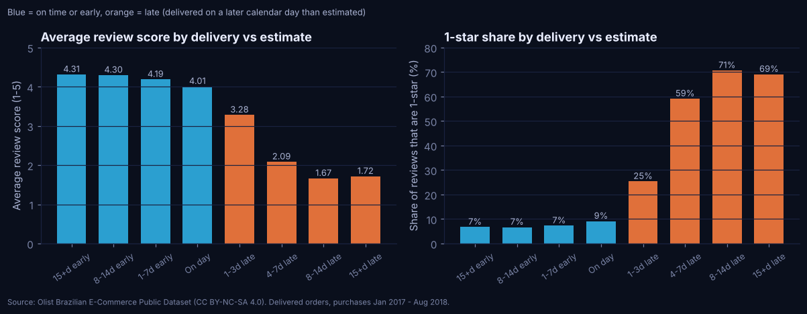
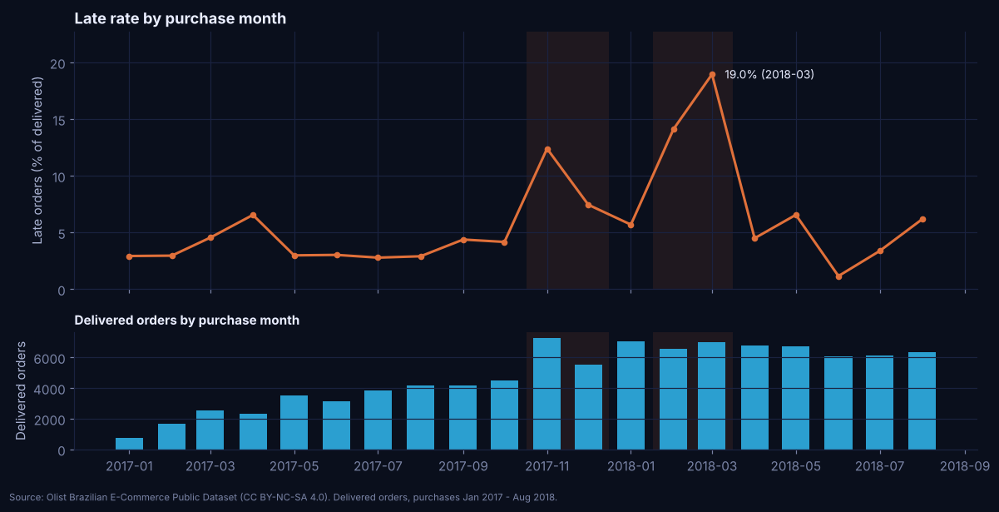
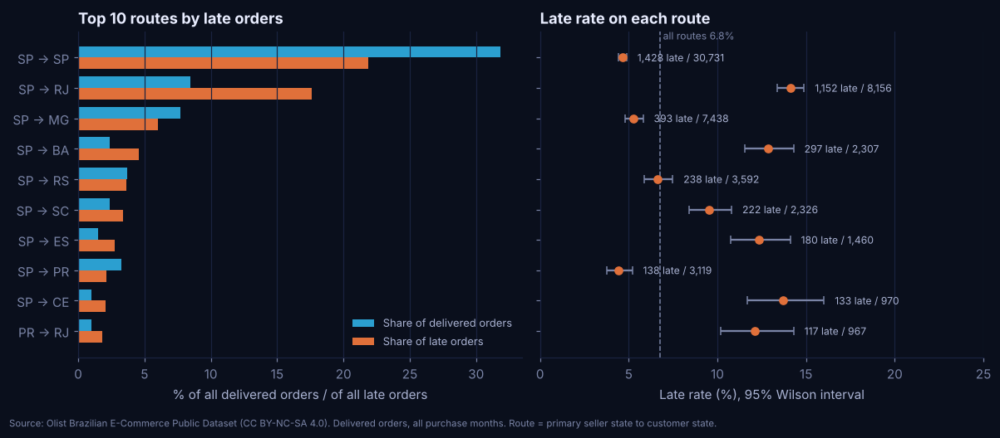

# Olist Delivery Experience

How much does late delivery cost in review scores, and where do the late orders come from? I answer that on
the public Olist marketplace dataset (99,441 Brazilian orders, 2016-2018) with a DuckDB SQL pipeline, an
independent pandas rebuild that has to agree with it, a Power BI model kit and the data behind the portfolio
site's case study.

> **Data and licence.** Brazilian E-Commerce Public Dataset by Olist
> ([Kaggle](https://www.kaggle.com/datasets/olistbr/brazilian-ecommerce)), CC BY-NC-SA 4.0. Raw files are not
> in this repository. Everything published here is an aggregate derived from them, shared for non-commercial use
> with attribution under the same licence. No review text is published.

## Question

How much does late delivery cost in customer review scores, and where do the late orders come from
(seller-to-customer routes, states, categories, time)? Supporting questions: how accurate are the delivery
estimates, which routes and categories carry more than their share of late orders, how on-time performance
moved month by month, and, for context, revenue by category and repeat buying.

## What I found

All values come from [`docs/findings.md`](docs/findings.md), which gives each one's definition, source table,
baseline and limits.

| | |
|---|---|
| Delivered orders that arrived late | **6.8%** (6,534 of 96,470) |
| Median arrival vs estimate | **12 days early** |
| Average review, on time or early / late | **4.28 / 2.26** stars |
| Late orders with a 1-star review | **54.2%** (on time: 6.8%) |
| Share of late orders on São Paulo → Rio de Janeiro | **17.6%** (8.5% of delivered orders) |
| Worst purchase month | **19.0%** late (March 2018) |
| Customers who bought again | **2.2%** |

1. **Late orders score about two stars lower**, and the gap is almost the same when I compare orders within
   the same state, category or seller. It is a correlation; I have not measured an effect.
2. **Estimates are padded**: 78.9% of orders arrive a week or more early, yet 6.8% still miss.
3. **Late orders cluster on a few routes.** SP → RJ alone has about 600 more late orders than the average rate
   would give; no product category has more than 64.
4. **Four purchase months (Nov-Dec 2017, Feb-Mar 2018) produced 55% of late orders** from 27% of volume. In
   Feb-Mar 2018 carrier transit grew by about 4.6 days while seller handling barely moved.
5. **70% of reviews on late orders were answered before the parcel arrived**, 91% of the 1- and 2-star ones.







More figures: [estimate accuracy](outputs/figures/estimate_accuracy.png),
[delivery legs by month](outputs/figures/delivery_legs.png).

## How it works

```
9 raw CSVs ──► sql/00_schema   raw landing tables (all text, explicit columns)
 (local,       sql/01_staging  typed tables, TRY_CAST, review text reduced to flags
  not in git)  sql/02_transf.  order fact + item fact, delivery outcome, review rule, primary seller/category
               sql/03_analytics marts: buckets, monthly series, routes, categories, cohorts, reconciliation
               sql/04_validation 68 checks ── any failed 'error' check stops the build
      │
      └──────► pandas (clean.py, analyze.py) rebuilds the same metrics without touching the database
                         │
                 reconcile.py: 40 metrics + 12 whole tables, SQL vs pandas ── any mismatch stops the export
                         │
                 export.py ──► outputs/ (analysis CSVs, figures), data/sample/ (Power BI), website JSON
```

| Module | Responsibility |
|---|---|
| [`config.py`](src/olist_delivery/config.py) | paths, source metadata, expected row counts, bucket edges, thresholds |
| [`ingest.py`](src/olist_delivery/ingest.py) | finds the raw folder, explains how to get the data, counts rows with a CSV parser, checksums |
| [`database.py`](src/olist_delivery/database.py) | runs `sql/00`-`04` in DuckDB, prints and enforces the validation results |
| [`clean.py`](src/olist_delivery/clean.py) | pandas typing and rules: late definition, review de-duplication, fan-out-safe joins, reconciliation classes |
| [`analyze.py`](src/olist_delivery/analyze.py) | pandas metrics and tables, Wilson intervals, Welch test |
| [`reconcile.py`](src/olist_delivery/reconcile.py) | SQL vs pandas comparison |
| [`figures.py`](src/olist_delivery/figures.py) | README figures (site palette, no dual axes) |
| [`export.py`](src/olist_delivery/export.py) | analysis CSVs, Power BI tables, website JSON, privacy and size guard |
| [`cli.py`](src/olist_delivery/cli.py) | `check`, `build`, `analyze`, `export`, `all` |

The SQL is DuckDB 1.5 dialect (`QUALIFY`, `FILTER`, `getvariable`, `read_csv`). It includes CTEs, window
functions (ranking, running and rolling sums, `LAG`), conditional aggregation, a monthly time series, a
customer cohort query, primary-key and duplicate checks, referential-integrity checks for every relationship,
a join fan-out test and a payments-vs-items reconciliation.

### Key definitions

| Term | Definition |
|---|---|
| Timing population | status `delivered` with delivery and estimated dates (96,470 orders). The other 2,971 are counted by outcome, never dropped. |
| Late | delivered on a later **calendar day** than the estimate. Estimates are stored at midnight, so a timestamp rule would call same-day deliveries late (8.1% instead of 6.8%). |
| Review per order | latest answered review; ties by creation date, then review id. A review shared by several orders counts for each. |
| Route / category | primary seller state → customer state; primary category. "Primary" = most item revenue in the order. |
| Revenue | item price + freight (BRL). No costs exist in the data, so there is no profit or margin anywhere. |
| Repeat customer | `customer_unique_id` with delivered orders on two or more purchase days. |

Full detail: [`docs/methodology.md`](docs/methodology.md). Columns and tables:
[`docs/data-dictionary.md`](docs/data-dictionary.md).

## Run it

```bash
cd projects/olist-delivery-experience
python -m venv .venv && source .venv/bin/activate      # Windows: .venv\Scripts\activate
pip install -r requirements-dev.txt

# Raw data: see data/README.md (Kaggle CLI or manual download into data/raw/)
export OLIST_DATA_DIR=/path/to/olist/csvs              # or keep them in data/raw/

PYTHONPATH=src python -m olist_delivery all            # check + build + validate + reconcile + export
python -m pytest                                       # 60 tests; 7 skip if the raw data is not present
```

`all` takes about 30 seconds. Each step can also run on its own: `check` (row counts, checksums, version),
`build` (DuckDB database in `data/interim/`, git-ignored), `analyze` (pandas rebuild and reconciliation),
`export`.

| Output | Purpose |
|---|---|
| `outputs/analysis/*.csv` | every SQL mart as CSV, plus the peak-period comparison |
| `outputs/validation_results.csv`, `outputs/reconciliation.csv` | check results and SQL vs pandas comparison |
| `outputs/source_check.json`, `outputs/statistics.json` | source version and counts; statistical comparisons |
| `outputs/figures/*.png` | the figures above |
| `data/sample/*.csv` | Power BI star schema (aggregates, about 450 KB) |
| `../../website/src/data/generated/olist-delivery-experience/*.json` | case-study data, documented in [`outputs/website-data/README.md`](outputs/website-data/README.md) |
| [`notebooks/exploratory_analysis.ipynb`](notebooks/exploratory_analysis.ipynb) | the profiling I did before fixing the definitions (executed, outputs saved) |

## Power BI

See [`powerbi/README.md`](powerbi/README.md): model diagram, relationships, four report pages, refresh steps
and the value each measure should return. The M queries, DAX and theme are written and the CSVs are checked
in Python, but **no `.pbix` or `.pbip` exists** and nothing has been run in Power BI Desktop, which was not
available where I built this.

## Data quality

[`docs/data-quality-report.md`](docs/data-quality-report.md). In short: 52 of 52 error-level checks pass;
10 known issues are recorded and handled (775 orders without items, 610 products without a category, 23
delivered orders with out-of-order carrier dates, and others); SQL and pandas agree on 52 of 52 comparisons.

**Source version.** Kaggle could not be reached from the build environment, so the files came from a public
GitHub mirror (retrieved 2026-10-11, checksums recorded). Eight files match Kaggle version 2 exactly. The
reviews file has 100,000 rows against 99,224 in Kaggle v2: it is the dataset's earlier review release. Review
figures could shift slightly on Kaggle v2; the pipeline accepts either.

## Limitations

* Observational data. Every link between lateness and reviews is an association; I have no experiment and no
  carrier, shipping-method or promotion fields to control for.
* Many late-order reviews were written before the parcel arrived, so the scores mix waiting with the product.
* Routes use the primary seller; 1.3% of orders have more than one seller.
* The last purchase months are cut off by the end of the data, which can make them look faster than they were.
* No costs, so no profit or margin. Revenue is what customers were charged for items and freight.
